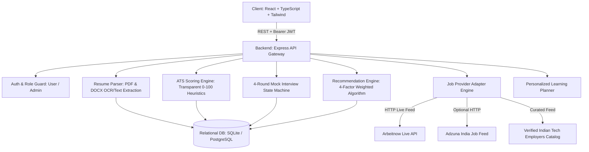

# AI Career Assistant — Architecture & Technical Specifications

## 1. System Architecture

The AI Career Assistant platform is designed as a decoupled, multi-tier full-stack application built for Indian job seekers, engineering graduates, and experienced professionals.



---

## 2. ATS Resume Scoring Algorithm (Transparent Criteria)

Unlike opaque "black-box" checkers, AI Career Assistant calculates an objective, explainable score from 0–100 using a weighted composite formula:

$$\text{ATS Score} = (0.30 \times S_{\text{skills}}) + (0.25 \times S_{\text{exp}}) + (0.15 \times S_{\text{contact}}) + (0.10 \times S_{\text{summary}}) + (0.10 \times S_{\text{edu}}) + (0.10 \times S_{\text{formatting}})$$

### Criteria Breakdown:
1. **Technical Skills Alignment (30%)**: Matches extracted resume keywords against industry benchmarks for the selected target role (e.g. React, TypeScript, Node.js, SQL, Python).
2. **Experience & Projects (25%)**: Evaluates project ownership, action verbs (designed, scaled, deployed), and quantifiable impact metrics (Google X-Y-Z formula).
3. **Contact Information & Links (15%)**: Validates email address format, 10-digit phone number, GitHub/portfolio links.
4. **Professional Summary (10%)**: Checks for a targeted opening objective summarizing domain strengths.
5. **Education & Academics (10%)**: Verifies degree, graduation year, and university presence (flexible for students and freshers).
6. **Layout & Formatting (10%)**: Scans for parsing obstacles: complex multi-column tables, scanned image pages without OCR text, or non-standard headings.

---

## 3. Four-Round Mock Interview State Machine

The recruitment simulator implements a strict server-side finite state machine:

```
[Round 1: Intro & Communication] 
      │ (Pass score >= 70%)
      ▼
[Round 2: Aptitude Assessment (Timed MCQs)] 
      │ (Pass score >= 70%)
      ▼
[Round 3: Core Technical & Architecture] 
      │ (Pass score >= 70%)
      ▼
[Round 4: HR & Behavioral Culture Alignment]
      │
      ▼
[Comprehensive Readiness Report]
```

### State Rules:
- **Round Locking**: Rounds 2, 3, and 4 are strictly locked at inception. Frontend inspection or direct API POSTs to locked rounds return `400 Bad Request`.
- **Pass Threshold**: Configurable via admin settings (default: 70%).
- **Retry Mechanism**: If a round score falls below 70%, the round status transitions to `FAILED`. Candidates receive actionable feedback and can trigger `retryRound` to practice again.
- **Persistence**: All user answers, timestamps, timer countdowns, and evaluations are persisted in the relational database, surviving browser refresh and device changes.

---

## 4. Intelligent Job Recommendation Algorithm

Recommendations are ranked according to a 4-factor multi-dimensional score:
- **Skills Match (50%)**: Direct overlap between candidate's extracted resume skills and the employer's required tech stack.
- **Role Similarity (25%)**: Semantic overlap between candidate's preferred roles and the vacancy title.
- **Experience Match (15%)**: Fresher and internship prioritization (experience 0–1 yrs matches freshers with a 100% experience factor).
- **Location Match (10%)**: Proximity to candidate's preferred cities (Bengaluru, Pune, Hyderabad, Delhi NCR, Chennai, Mumbai) or full remote flexibility.
